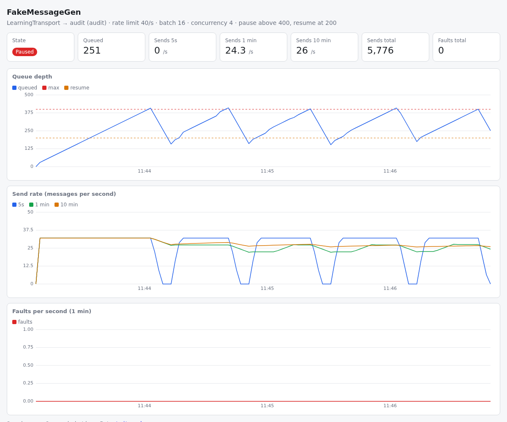

# FakeMessageGen

[](https://github.com/ramonsmits/FakeMessageGen/actions/workflows/ci.yml) [](https://www.nuget.org/packages/NBraceIT.FakeMessageGen)

## What

This is a tool to generates fake NServiceBus messages without requiring processing first. Its purpose is to generate a large set of message for ingestion by Particular Software its ServiceControl audit and error ingestion software.

## Install

This tool requires the [.net sdk](https://dotnet.microsoft.com/en-us/download/dotnet).

Installation:
```con
dotnet tool install -g NBraceIT.FakeMessageGen
```

Update:
```
dotnet tool update -g NBraceIT.FakeMessageGen
```

## Versioning

Versions follow `YYYY.RELEASECOUNT.PATCH`:

- `YYYY` — the year of the release
- `RELEASECOUNT` — the release number within that year, starting at 1
- `PATCH` — hotfix number for that release, starting at 0

For example, `2026.1.0` is the first release of 2026 and `2026.1.1` a hotfix for it. Versions are derived from git tags using [MinVer](https://github.com/adamralph/minver). Releases before 2026.1.0 used semantic versioning (`1.0.0` to `2.0.0`).

## Release

Releases are made by pushing a version tag. The [release workflow](.github/workflows/release.yml) packs the tool with that version, pushes it to nuget.org and creates a GitHub release using the matching `CHANGELOG.md` section, so add that section first.

Publishing uses [nuget.org Trusted Publishing](https://learn.microsoft.com/en-us/nuget/nuget-org/trusted-publishing) (OpenID Connect, no stored API key). One-time setup:

1. On nuget.org open your profile menu, **Trusted Publishing**, and add a policy with repository owner `ramonsmits`, repository `FakeMessageGen`, workflow file `release.yml` (no environment).
2. Add the repository secret `NUGET_USER` containing the nuget.org profile name that owns the package (not the e-mail address).

```
git tag 2026.1.0
git push origin 2026.1.0
```

Every push and pull request is built on Linux and Windows by the [CI workflow](.github/workflows/ci.yml).

## Help

The command line help output:

```
FakeMessagGen.exe destination isError [maxQueueLength] [rateLimit] [maxConcurrency] [batchSize] [connectionString]

    destination:
        The queue name to send messages to. It must already exist;
        this tool never creates queues. Start the consuming endpoint
        (for example ServiceControl) first.

    isError:
        true    — generate fake error messages.
        false   — generate fake audit messages.

    maxQueueLength (default 10000):
        Pauses sending when the destination is above this depth.
        Sending resumes when the depth is at or below half of it.

    rateLimit (default 5000):
        Max messages per second (taking batchSize into account).

    maxConcurrency (default 100):
        Number of concurrent batches in flight.

    batchSize (default 16):
        Number of messages per batch send.

    connectionString:
        Connection to use. If not specified, the tool probes environment and config.
        Recognized formats:
            Azure Service Bus — starts with "Endpoint="
            RabbitMQ          — starts with "host="
            Learning          — path-like (/foo or C:\foo)
            MSMQ              — "msmq" (Windows only, destination can be queue@machine)

Tip: If you omit connectionString, it will try to resolve it from env or config.

Output is a full-screen UI when attached to a terminal that supports ANSI escape sequences,
and plain lines (one queue length, send rate and fault line every 2s)
when stdout is redirected or the console has no ANSI support (legacy Windows console).
Set FAKEMESSAGEGEN_PLAIN=1 to force plain lines.

A web view with graphs of the queue depth, send rates and faults listens on
http://localhost:5080/ (last hour). Set FAKEMESSAGEGEN_WEB to another port, or to 0 to disable it.
```

> The destination queue is never created by this tool: the transport is initialised with no receivers
> and no sending addresses, and MSMQ additionally runs with `CreateQueues = false`. Start the endpoint
> that owns the queue first — with ServiceControl that means running its setup so the `audit` (or
> `error`) queue exists.

## Output

The tool has two output modes and picks one at startup:

| Mode | When | What you get |
|------|------|--------------|
| Interactive | stdout is a terminal that renders ANSI escape sequences | Full-screen UI with a main, queue length and log frame, updated live |
| Plain | stdout is redirected (file, pipe, scheduled task, service, CI, `Start-Process -RedirectStandardOutput`), the console has no ANSI support, or `FAKEMESSAGEGEN_PLAIN=1` is set | Startup settings, then one line every 2 seconds with the queue length, send rates and faults, plus NServiceBus log output at Info level and above. No escape sequences |

Plain output looks like this:

```
         Using: LearningTransport
     RateLimit: 200.00/s
     BatchSize: 16
   Destination: audit
       IsError: False
MaxQueueLength: 100,000
MaxConcurrency: 10
Press CTRL+C to exit...
2026-10-30 10:37:27 [queued:        112 Rates/sec [5s:    48.0/s] [10s:    48.0/s] [1min:    48.0/s] [10min:    48.0/s] [1hr:    48.0/s] [lifetime:    55.8/s] [faults:      0 1min:   0.0/s]
2026-10-30 10:37:29 [queued:        208 Rates/sec [5s:    48.0/s] [10s:    48.0/s] [1min:    48.0/s] [10min:    48.0/s] [1hr:    48.0/s] [lifetime:    51.9/s] [faults:      0 1min:   0.0/s]
Paused until at or below 100
```

## Metrics

The rate line reports messages that the transport accepted. A batch that fails counts as faults, not as sends.

| Column | Meaning |
|--------|---------|
| `queued` | Depth of the destination queue, read from the transport every 2 seconds |
| `5s` to `1hr` | Average sends per second over the last complete seconds of that window. When the tool has run shorter than the window, the average is over the uptime, so a fresh start shows the real rate and not a rate diluted by the full window |
| `lifetime` | Sends divided by the uptime, pauses included |
| `faults` | Total failed messages, and the failed messages per second over the last minute |

Sending pauses when the queue depth is above `maxQueueLength` and resumes when it is at or below half of it. The gap keeps the sender from flapping on the threshold at every check.

The counters are also published as the .NET meter `FakeMessageGen` (instruments `sends` and `faults`), so they can be read from a running process without the log:

```
dotnet tool install -g dotnet-counters
dotnet-counters monitor -n fakemessagegen --counters FakeMessageGen
```

When the tool runs as a Windows service, run `dotnet-counters` from an elevated session.

## Web view



The tool serves a page with graphs on `http://localhost:5080/`: the queue depth with the pause and resume
lines, the send rate over 5 seconds, 1 minute and 10 minutes, and the faults per second. The page keeps
the last hour, one sample every 2 seconds, and follows the light or dark theme of the browser.

- `FAKEMESSAGEGEN_WEB=<port>` selects another port. `FAKEMESSAGEGEN_WEB=0` disables the web view.
- The listener binds to `localhost` only. To open the page of a tool that runs on another machine, use an SSH tunnel or an RDP session on that machine.
- When the port is in use, the tool logs a line and runs without the web view.
- `GET /api/samples` returns the settings and the samples as JSON. `?after=<ticks>` returns only the samples newer than that .NET UTC tick count.

ANSI support on Windows is detected by asking the console to enable virtual terminal processing
(`SetConsoleMode` with `ENABLE_VIRTUAL_TERMINAL_PROCESSING`). Windows Terminal has it on already; the
classic console host used by `cmd.exe` on Windows Server supports it since Server 2016 but leaves it off
until the application turns it on, which the tool now does. If enabling fails (legacy console) the tool
falls back to plain output instead of printing escape sequences as garbage. On Linux and macOS a
terminal is assumed to support ANSI unless `TERM` is empty or `dumb`.

## Transports

| Transport | Connection string format | Environment variable |
|-----------|--------------------------|----------------------|
| Azure Service Bus | starts with `Endpoint=` | `CONNECTIONSTRING_AZURESERVICEBUS` |
| RabbitMQ | starts with `host=` | `CONNECTIONSTRING_RABBITMQ` |
| Learning | path-like (`/foo` or `C:\foo`) | `CONNECTIONSTRING_LEARNING` |
| MSMQ | `msmq` | `CONNECTIONSTRING_MSMQ` |

When no connection string is passed, all environment variables containing `CONNECTIONSTRING` are probed and a selection menu is shown.

### MSMQ

MSMQ is only available on Windows. The destination can be a local queue name (`audit`) or a remote queue (`audit@machine`). Messages are sent to transactional queues in one native MSMQ transaction per batch, and the queue length is read via the MSMQ management API.

The MSMQ transport is compiled in from the [NServiceBus.Transport.Msmq.Sources](https://docs.particular.net/nuget/NServiceBus.Transport.Msmq.Sources) source package (and its `Particular.Msmq` dependency). These packages only target `net10.0-windows`, and a dotnet tool cannot target a Windows specific framework, so the project downloads the packages and compiles their sources into the `net10.0` build. They are only published on the Particular Software feed, which is configured in `nuget.config`.
